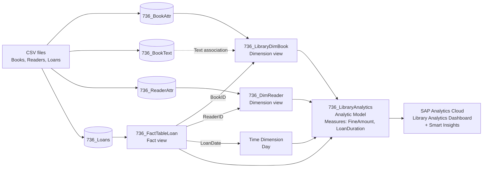

# Library Analytics with SAP Datasphere and SAP Analytics Cloud

**End-to-end SAP analytics solution for library loans and fines: a star schema with dimension and fact views, associations and an analytic model in SAP Datasphere, reported in an interactive SAP Analytics Cloud dashboard with Smart Insights.**


---

## At a Glance

| Metric | Result |
|---|---|
| Loans analysed | **800** |
| Total fines collected | **EUR 10,228** |
| Average fine per loan | **EUR 13** |
| Most borrowed genre | **Mystery (141 loans)**, followed by Science Fiction (113) and Fantasy (112) |
| Highest fine per book | **EUR 63** (*Library of Tomorrow Vol 1*), found with SAC Smart Insights |
| Data model | **4 tables, 3 views, 1 analytic model** (star schema) in SAP Datasphere |

---

## Dashboard


- **KPI cards:** total loans, total fines collected and average fine per loan
- **Most borrowed genres:** loan count per genre
- **Monthly fine collection:** fine trend across the year
- **Fines and loans by genre and loan status:** active vs. overdue loans per genre
- **Fine amount per book:** the books with the highest fines compared to the average line, identified with **Smart Insights**

---

## Business Problem

A library wants to understand how its collection is used and where fines come from:

1. **Which genres and books are borrowed most?** (for purchasing and shelf planning)
2. **How do fines develop over the year, and which books cause the highest fines?**
3. **How many loans are overdue, and in which genres?**

---

## Key Insights

1. **Mystery is the most borrowed genre** with **141 loans**, clearly ahead of Science Fiction (113) and Fantasy (112). Thriller has the fewest loans (68).
2. **Fines are concentrated in the first months of the year.** Fine collection peaks in **January (EUR 1,463)** and **April (EUR 1,376)**, then drops to about **EUR 500 to 700 per month** from May onwards.
3. **A few books drive the highest fines.** *Library of Tomorrow Vol 1* (**EUR 63**) and *Silent Algorithms Vol 2* (**EUR 61**) are well above the average fine per book.
4. **Overdue loans are a real share of activity.** In Drama alone, **38 loans are overdue** compared to 31 active loans.

### Recommendations

- **Buy extra copies of Mystery, Science Fiction and Fantasy titles** to match demand.
- **Send reminder notifications** before due dates, especially in the high-fine months at the start of the year.
- **Review loan periods for the books with the highest fines**, which are often in high demand.

---

## Data Model

### Architecture



The model follows a **star schema** in SAP Datasphere:

| Layer | Objects | Purpose |
|---|---|---|
| **Tables** | `736_BookAttr`, `736_BookText`, `736_ReaderAttr`, `736_Loans` | Raw data loaded from CSV files |
| **Dimension views** | `736_LibraryDimBook`, `736_DimReader` | Book attributes (author, genre, publisher, language, rating) and reader attributes (age, membership type, city, department) |
| **Text association** | `736_BookText` on `736_LibraryDimBook` | Book title and description as text for the BookID |
| **Fact view** | `736_FactTableLoan` | One row per loan: dates, loan duration, late return days, fine amount, loan status |
| **Associations** | BookID, ReaderID, LoanDate | Connect the fact view to the book, reader and time dimensions |
| **Analytic model** | `736_LibraryAnalytics` | Measures **FineAmount** and **LoanDuration**, 31 dimension attributes, ready for SAC |

### E/R Model


### Analytic Model


---

## Tech Stack

| Area | Tools |
|---|---|
| Data modelling | SAP Datasphere (tables, dimension and fact views, associations, text association, E/R model) |
| Semantic layer | SAP Datasphere Analytic Model (measures, dimensions, time dimension) |
| Reporting | SAP Analytics Cloud (story, KPI cards, charts, table) |
| Augmented analytics | SAC Smart Insights |

---

## Repository Structure

```
sap-datasphere-library-analytics/
├── Library analytics dashboard.png   # SAC dashboard
├── Er Model.png                      # E/R model in SAP Datasphere
├── Analytical Model.png              # Analytic model in SAP Datasphere
├── architecture_library.png          # Architecture diagram
└── README.md
```

---

## How to Reproduce

1. **Prepare the data:** create CSV files for books (attributes and texts), readers and loans with the columns shown in the E/R model. The dataset in this project is synthetic.
2. **Load into SAP Datasphere:** upload the CSV files as local tables (`736_BookAttr`, `736_BookText`, `736_ReaderAttr`, `736_Loans`).
3. **Build the dimension views:** set the semantic usage to *Dimension* for books and readers, and add `736_BookText` as a text association.
4. **Build the fact view** on the loans table and add associations to the book and reader dimensions and to a day-level time dimension on `LoanDate`.
5. **Create the analytic model** `736_LibraryAnalytics` with the measures `FineAmount` and `LoanDuration`, and deploy it.
6. **Build the SAC story** on the analytic model and use **Smart Insights** on the fine amount per book.

---

## Next Steps

- **Predict overdue loans** with SAC Smart Predict based on reader and book attributes
- Add **hierarchies** (for example genre and author, or city and department) for drill-down analysis
- Build a **planning model** in SAC for the purchasing budget per genre
- Connect live library system data instead of CSV files

---

## Author

**Mayuresh Parche**
M.Sc. Software Engineering, Hochschule Heilbronn | SAP Certified Data Analyst (SAP Analytics Cloud)

[LinkedIn](https://www.linkedin.com/in/mayureshparche/) | [GitHub](https://github.com/Mayureshp21)
